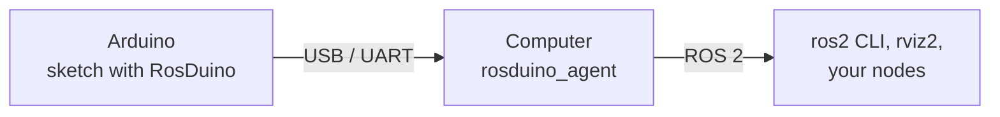

# RosDuino ROS 2

[Русский](README_RU.md)

**The computer side of RosDuino.** A board running the [RosDuino Arduino library](https://github.com/rosduino/rosduino_arduino) becomes a ROS 2 node. This repository is the program that sits on the computer and the tool that writes message headers for the sketch.

```bash
ros2 run rosduino_agent rosduino_agent --port /dev/ttyUSB0
ros2 topic pub --once /led std_msgs/msg/Bool "{data: true}"   # the onboard LED turns on
```

## Why

The sketch on the board declares a node name, topics, and services. Something on the computer has to open the serial port, create those ROS 2 entities, and move messages both ways. `rosduino_agent` is that program. Change the sketch, flash the board, and the next connection picks up the new topics and services.

`rosduino-gen` writes the C++ headers a sketch needs for your own `.msg` and `.srv` files. The common types already ship with the library.

## Packages

| Package | What it is |
|---|---|
| [`rosduino`](rosduino/README.md) | Metapackage. Depending on it pulls in the agent and the generator. |
| [`rosduino_agent`](rosduino_agent/README.md) | One process per board. Opens a serial port or a TCP connection and exposes the board as a ROS 2 node. |
| [`rosduino_gen`](rosduino_gen/README.md) | `rosduino-gen`: C++ headers for Arduino from ROS 2 `.msg` and `.srv` files. |



To the rest of ROS 2 the board is an ordinary node: it shows up in `ros2 node list`, and its topics and services work with `ros2 topic`, `rviz2`, rqt, and your own nodes.

## Requirements

- Linux with ROS 2 **Lyrical** (recommended) or **Jazzy**.
- A board flashed with [RosDuino](https://github.com/rosduino/rosduino_arduino). The agent and the library talk at 115200 baud unless you change both sides.

On Jazzy the board cannot *offer* a service. Topics, and service calls *from* the board, still work.

These packages build with `colcon` on Linux. On macOS and Windows, run the agent on a Linux machine or in a Linux environment that can open the serial device. If the board stays on another computer, point the agent at `tcp://host:port` (see [Port](#port)).

## Install

```bash
git clone https://github.com/rosduino/rosduino_ros.git
cd rosduino_ros
source /opt/ros/$ROS_DISTRO/setup.bash
colcon build
source install/setup.bash
```

This repository builds on its own. The Arduino library checkout is a separate repository.

Add your user to the `dialout` group so the agent can open the port without root, then log in again:

```bash
sudo usermod -aG dialout "$USER"
```

## Quick start

Flash **File → Examples → RosDuino → Simple → Led** from the Arduino library, then start the agent on the same port the IDE used:

```bash
ros2 run rosduino_agent rosduino_agent --port /dev/ttyUSB0
```

In a second terminal, with the workspace sourced:

```bash
ros2 node list          # /led_board
ros2 topic echo /led
ros2 topic pub --once /led std_msgs/msg/Bool "{data: true}"
ros2 topic pub --once /led std_msgs/msg/Bool "{data: false}"
```

Stop the agent before uploading a new sketch, or the port stays busy.

| Board on Linux | Typical port |
|---|---|
| Nano, and other USB-serial adapters | `/dev/ttyUSB0` |
| Uno, Micro, Mega, Due | `/dev/ttyACM0` |

## Port

`--port` is either a serial device or a TCP address. The same names are ROS parameters (see below).

```bash
ros2 run rosduino_agent rosduino_agent --port /dev/ttyACM0 --baud 115200
ros2 run rosduino_agent rosduino_agent --port tcp://192.168.1.20:5760
```

A TCP address is an outbound connection. The agent retries every second until something accepts it and forwards bytes to the board. `--baud` applies to a serial device.

One process is one port, one board, and one ROS 2 node. The node name comes from the sketch (`ros.begin("led_board")`). If that name is already on the graph, the agent uses `led_board_2`, then `led_board_3`, and so on. A non-empty `--namespace` replaces the namespace from the sketch.

Ctrl+C ends the session and removes the node's topics and services. With `--keep-on-disconnect`, a dropped link leaves them in place until the agent exits.

### Several boards

[`rosduino_agent.launch.py`](rosduino_agent/launch/rosduino_agent.launch.py) starts one agent per port. `ports` is a comma-separated list. Without it, the launch file uses `port`.

```bash
ros2 launch rosduino_agent rosduino_agent.launch.py port:=/dev/ttyUSB0
ros2 launch rosduino_agent rosduino_agent.launch.py ports:=/dev/ttyUSB0,/dev/ttyACM0 baud:=115200
```

## Options

Each flag sets a ROS parameter. A launch file passes those parameters directly.

| Flag | Parameter | Default | Effect |
|---|---|---|---|
| `--port` | `port` | required | Serial device, or `tcp://host:port` |
| `--baud` | `baud` | `115200` | Serial baud. Must match the sketch |
| `--namespace` | `namespace` | empty | Replaces the namespace from the sketch |
| `--keep-on-disconnect` | `keep_on_disconnect` | `false` | Keep ROS entities when the link drops |
| `--service-timeout-ms` | `service_timeout_ms` | `5000` | How long a service call may take |
| `--no-diagnostics` | `diagnostics` | `true` | Set the parameter to `false` to skip `/diagnostics` |
| `--log-level` | `log_level` | `info` | `debug`, `info`, `warn`, `error`, or `fatal` |

```bash
ros2 run rosduino_agent rosduino_agent --ros-args -p port:=/dev/ttyUSB0 -p baud:=57600
```

## Diagnostics

With diagnostics left on, the agent publishes `diagnostic_msgs/msg/DiagnosticArray` on `/diagnostics` at 1 Hz. The status name is `rosduino: <node>`.

| Level | When |
|---|---|
| OK | The board is connected and every declared entity exists |
| WARN | The link to the board is down, or an entity failed to register |
| ERROR | The port never opened |

`ros2 topic echo /diagnostics --field status` shows the port, session state, protocol version, board profile, entity counts, frame counts, and error counters.

## Your own message types

The Arduino library already includes headers for `std_msgs`, `std_srvs`, `example_interfaces`, `builtin_interfaces`, and the `geometry_msgs`, `sensor_msgs`, and `nav_msgs` types listed in [`arduino_types.txt`](rosduino_gen/arduino_types.txt). For a type that is not in that set, run `rosduino-gen` in a sourced ROS 2 workspace and copy the headers into the library.

```bash
ros2 run rosduino_gen rosduino-gen --list
ros2 run rosduino_gen rosduino-gen --list --package std_msgs
ros2 run rosduino_gen rosduino-gen --package my_robot_msgs --out "$HOME/Arduino/libraries/RosDuino/src"
ros2 run rosduino_gen rosduino-gen --all
```

| Flag | Effect |
|---|---|
| `--list` | Print interface names (`pkg/msg/Name`, `pkg/srv/Name`) and exit. Without `--package`, print every interface ROS 2 knows |
| `--package PKG` | Generate one package. Repeat the flag for several packages |
| `--all` | Clear the output directory, then generate the types in [`arduino_types.txt`](rosduino_gen/arduino_types.txt). Nested types are added on their own |
| `--out DIR` | Output directory. The default is `generated/` inside this package |
| `--default-seq-cap N` | Capacity of an unbounded array `T[]` (default 8) |
| `--parser auto\|simple\|rosidl` | Parser. `auto` uses the ROS 2 parser when it is installed |

Headers land in `pkg/msg/Name.h` and `pkg/srv/Name.h`. A sketch includes them the ROS 2 way:

```cpp
#include <my_robot_msgs/msg/Status.h>

my_robot_msgs::Status status;
```

What the header contains, and where to copy it: [`rosduino_gen/README.md`](rosduino_gen/README.md). The comparison with `rosidl_generator_cpp` headers is in Russian: [`rosduino_gen/doc/arduino_due.md`](rosduino_gen/doc/arduino_due.md).

To change the set that `--all` writes, edit `arduino_types.txt` and run `--all` again. A line is a whole package or one type, `pkg/msg/Name` or `pkg/srv/Name`.

## Check the build

```bash
colcon test
colcon test-result
```

## License

[Apache-2.0](LICENSE).
