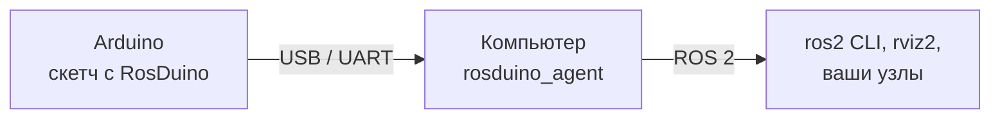

# RosDuino ROS 2

[English](README.md)

**Пакет ROS для связи с RosDuino.** Плата с [библиотекой RosDuino для Arduino](https://github.com/rosduino/rosduino_arduino) становится узлом ROS 2. В этом репозитории — программа, которая работает на компьютере, и инструмент, который пишет заголовки сообщений для скетча.

```bash
ros2 run rosduino_agent rosduino_agent --port /dev/ttyUSB0
ros2 topic pub --once /led std_msgs/msg/Bool "{data: true}"   # светодиод на плате загорелся
```

## Зачем это нужно

Скетч на плате объявляет имя узла, топики и сервисы. На компьютере кто-то должен открыть serial-порт, создать эти сущности ROS 2 и передавать сообщения в обе стороны. Это делает `rosduino_agent`. Поменяли скетч и прошили плату — следующее соединение подхватит новые топики и сервисы.

`rosduino-gen` пишет C++-заголовки для ваших `.msg` и `.srv`. Распространённые типы уже лежат в библиотеке.

## Пакеты

| Пакет | Что это |
|---|---|
| [`rosduino`](rosduino/README_RU.md) | Метапакет. Зависимость от него тянет агент и генератор. |
| [`rosduino_agent`](rosduino_agent/README_RU.md) | Один процесс на плату. Открывает serial-порт или TCP и показывает плату как узел ROS 2. |
| [`rosduino_gen`](rosduino_gen/README_RU.md) | `rosduino-gen`: C++-заголовки для Arduino из файлов ROS 2 `.msg` и `.srv`. |



Для остального ROS 2 плата — обычный узел: она есть в `ros2 node list`, а её топики и сервисы работают с `ros2 topic`, `rviz2`, rqt и вашими узлами.

## Что нужно

- Linux с ROS 2 **Lyrical** (основной дистрибутив) или **Jazzy**.
- Плата, прошитая [RosDuino](https://github.com/rosduino/rosduino_arduino). Агент и библиотека говорят на 115200 бод, пока вы не поменяете скорость с обеих сторон.

На Jazzy плата не может *предоставлять* сервис. Топики и вызовы сервиса *с* платы работают.

Пакеты собираются через `colcon` на Linux. На macOS и Windows запускайте агент на машине с Linux или в среде Linux, которая открывает serial-устройство. Если плата остаётся на другом компьютере, укажите агенту `tcp://host:port` (см. [Порт](#порт)).

## Установка

```bash
git clone https://github.com/rosduino/rosduino_ros.git
cd rosduino_ros
source /opt/ros/$ROS_DISTRO/setup.bash
colcon build
source install/setup.bash
```

Этот репозиторий собирается сам по себе. Каталог библиотеки Arduino — отдельный репозиторий.

Чтобы агент открывал порт без root, добавьте пользователя в группу `dialout` и войдите в систему заново:

```bash
sudo usermod -aG dialout "$USER"
```

## Быстрый старт

Прошейте пример **File → Examples → RosDuino → Simple → Led** из библиотеки Arduino и запустите агент на том же порту, который использовала IDE:

```bash
ros2 run rosduino_agent rosduino_agent --port /dev/ttyUSB0
```

Во втором терминале, с подключённым workspace:

```bash
ros2 node list          # /led_board
ros2 topic echo /led
ros2 topic pub --once /led std_msgs/msg/Bool "{data: true}"
ros2 topic pub --once /led std_msgs/msg/Bool "{data: false}"
```

Перед заливкой нового скетча остановите агент, иначе порт занят.

| Плата в Linux | Обычный порт |
|---|---|
| Nano и другие USB-serial адаптеры | `/dev/ttyUSB0` |
| Uno, Micro, Mega, Due | `/dev/ttyACM0` |

## Порт

`--port` — это либо serial-устройство, либо адрес TCP. Те же имена есть у параметров ROS (см. ниже).

```bash
ros2 run rosduino_agent rosduino_agent --port /dev/ttyACM0 --baud 115200
ros2 run rosduino_agent rosduino_agent --port tcp://192.168.1.20:5760
```

Адрес TCP — исходящее соединение. Агент повторяет попытку раз в секунду, пока кто-то не примет его и не перешлёт байты на плату. `--baud` относится к serial-устройству.

Один процесс — один порт, одна плата и один узел ROS 2. Имя узла берётся из скетча (`ros.begin("led_board")`). Если такое имя уже есть в графе, агент берёт `led_board_2`, затем `led_board_3` и так далее. Непустой `--namespace` заменяет пространство имён из скетча.

Ctrl+C завершает сессию и убирает топики и сервисы узла. С `--keep-on-disconnect` при обрыве связи они остаются, пока агент не завершится.

### Несколько плат

[`rosduino_agent.launch.py`](rosduino_agent/launch/rosduino_agent.launch.py) запускает по одному агенту на порт. `ports` — список через запятую. Без него launch-файл берёт `port`.

```bash
ros2 launch rosduino_agent rosduino_agent.launch.py port:=/dev/ttyUSB0
ros2 launch rosduino_agent rosduino_agent.launch.py ports:=/dev/ttyUSB0,/dev/ttyACM0 baud:=115200
```

## Параметры

Каждый флаг задаёт параметр ROS. Launch-файл передаёт эти параметры напрямую.

| Флаг | Параметр | По умолчанию | Эффект |
|---|---|---|---|
| `--port` | `port` | обязателен | Serial-устройство или `tcp://host:port` |
| `--baud` | `baud` | `115200` | Скорость serial. Должна совпадать со скетчем |
| `--namespace` | `namespace` | пусто | Заменяет пространство имён из скетча |
| `--keep-on-disconnect` | `keep_on_disconnect` | `false` | Оставить сущности ROS, когда связь пропала |
| `--service-timeout-ms` | `service_timeout_ms` | `5000` | Сколько может длиться вызов сервиса |
| `--no-diagnostics` | `diagnostics` | `true` | Параметр `false` отключает `/diagnostics` |
| `--log-level` | `log_level` | `info` | `debug`, `info`, `warn`, `error` или `fatal` |

```bash
ros2 run rosduino_agent rosduino_agent --ros-args -p port:=/dev/ttyUSB0 -p baud:=57600
```

## Диагностика

Если диагностику не отключали, агент публикует `diagnostic_msgs/msg/DiagnosticArray` в `/diagnostics` раз в секунду. Имя статуса — `rosduino: <node>`.

| Уровень | Когда |
|---|---|
| OK | Плата на связи, и каждая объявленная сущность создана |
| WARN | Связи с платой нет, или сущность не зарегистрировалась |
| ERROR | Порт так и не открылся |

`ros2 topic echo /diagnostics --field status` показывает порт, состояние сессии, версию протокола, профиль платы, число сущностей, число кадров и счётчики ошибок.

## Свои типы сообщений

В библиотеке Arduino уже есть заголовки для `std_msgs`, `std_srvs`, `example_interfaces`, `builtin_interfaces` и тех типов `geometry_msgs`, `sensor_msgs` и `nav_msgs`, которые перечислены в [`arduino_types.txt`](rosduino_gen/arduino_types.txt). Для типа вне этого списка запустите `rosduino-gen` в подключённом workspace ROS 2 и скопируйте заголовки в библиотеку.

```bash
ros2 run rosduino_gen rosduino-gen --list
ros2 run rosduino_gen rosduino-gen --list --package std_msgs
ros2 run rosduino_gen rosduino-gen --package my_robot_msgs --out "$HOME/Arduino/libraries/RosDuino/src"
ros2 run rosduino_gen rosduino-gen --all
```

| Флаг | Эффект |
|---|---|
| `--list` | Напечатать имена интерфейсов (`pkg/msg/Name`, `pkg/srv/Name`) и выйти. Без `--package` — все интерфейсы, которые знает ROS 2 |
| `--package PKG` | Сгенерировать один пакет. Флаг можно повторить |
| `--all` | Очистить каталог вывода и сгенерировать типы из [`arduino_types.txt`](rosduino_gen/arduino_types.txt). Вложенные типы добавляются сами |
| `--out DIR` | Каталог вывода. По умолчанию `generated/` в этом пакете |
| `--default-seq-cap N` | Ёмкость неограниченного массива `T[]` (по умолчанию 8) |
| `--parser auto\|simple\|rosidl` | Парсер. `auto` берёт парсер ROS 2, если он установлен |

Заголовки ложатся в `pkg/msg/Name.h` и `pkg/srv/Name.h`. Скетч подключает их так же, как в ROS 2:

```cpp
#include <my_robot_msgs/msg/Status.h>

my_robot_msgs::Status status;
```

Что внутри заголовка и куда его копировать: [`rosduino_gen/README_RU.md`](rosduino_gen/README_RU.md). Сравнение с заголовками `rosidl_generator_cpp`: [`rosduino_gen/doc/arduino_due.md`](rosduino_gen/doc/arduino_due.md).

Чтобы изменить набор для `--all`, поправьте `arduino_types.txt` и снова запустите `--all`. Строка — это пакет целиком или один тип, `pkg/msg/Name` или `pkg/srv/Name`.

## Проверка сборки

```bash
colcon test
colcon test-result
```

## Лицензия

[Apache-2.0](LICENSE).
